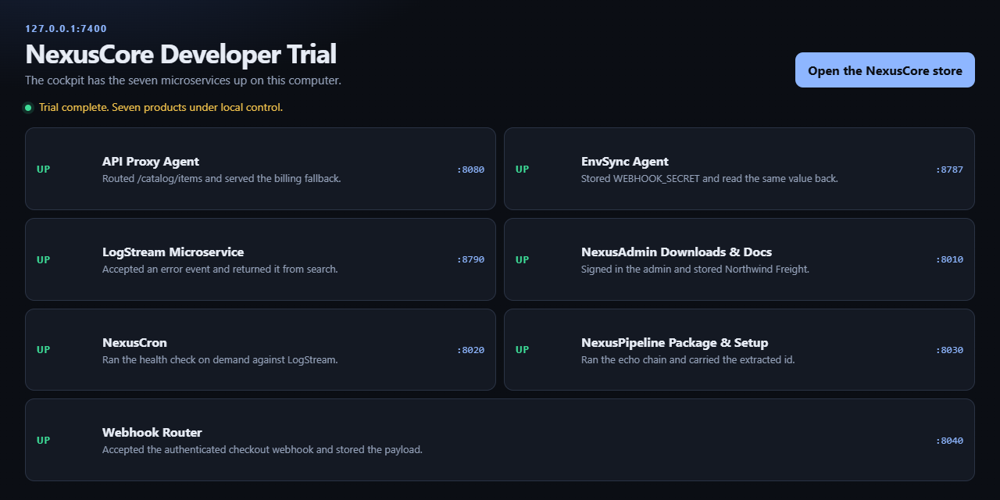

# NexusCore

[English](https://github.com/alfredobustamante19/NexusCore/blob/main/README.md) · [Español](https://github.com/alfredobustamante19/NexusCore/blob/main/README.spanish.md) · [عربي](https://github.com/alfredobustamante19/NexusCore/blob/main/README.arabic.md) · [বাংলা](https://github.com/alfredobustamante19/NexusCore/blob/main/README.bengali.md) · [Français](https://github.com/alfredobustamante19/NexusCore/blob/main/README.french.md) · [हिंदी](https://github.com/alfredobustamante19/NexusCore/blob/main/README.hindi.md) · [Indonesia](https://github.com/alfredobustamante19/NexusCore/blob/main/README.indonesian.md) · [汉语](https://github.com/alfredobustamante19/NexusCore/blob/main/README.mandarin-chinese.md) · [Português](https://github.com/alfredobustamante19/NexusCore/blob/main/README.portuguese.md) · [русский](https://github.com/alfredobustamante19/NexusCore/blob/main/README.russian.md) · [اردو](https://github.com/alfredobustamante19/NexusCore/blob/main/README.urdu.md)

This GitHub is the product docs and the free demo. [NexusCore](https://nexuscore-store.whop.site) is commercial. Licensed source ships after checkout on the [store](https://nexuscore-store.whop.site).

[Free demo sample](https://github.com/alfredobustamante19/NexusCore/blob/main/nexuscore_lite.py) 



**Stop renting your stack. Self-hosted developer tools you own.**

Cron, webhooks, pipelines, logs, env sync, and API retries on a VPS you already pay for. One lifetime license. Complete source after purchase. SQLite on disk. Telemetry off.

[](https://nexuscore-store.whop.site)
[](https://nexuscore-store.whop.site/guides/sqlite-webhook-routing)
[](https://nexuscore-store.whop.site)
[](https://nexuscore-store.whop.site)
[](https://nexuscore-store.whop.site)

[Store](https://nexuscore-store.whop.site) · [Guides](https://nexuscore-store.whop.site/guides) · [Architecture](https://nexuscore-store.whop.site/guides/self-hosted-architecture-guide) · [API Proxy](https://nexuscore-store.whop.site/guides/self-hosted-api-proxy) · [EnvSync](https://nexuscore-store.whop.site/guides/self-hosted-envsync)

[Quick start](#quick-start) · [How it works](#how-it-works) · [The suite](#the-suite) · [SaaS vs self-hosted](#saas-vs-self-hosted) · [What you run after checkout](#what-you-run-after-checkout) · [FAQ](#faq) · [Guides](#guides)

`DEVLAUNCH` → 20% off every lifetime license

---

## Why this exists

EasyCron, Hookdeck, Zapier, Doppler, Datadog, and API gateways all meter the same work: fire HTTP, route a payload, keep a `.env` in sync, retry an upstream.

NexusCore is that work as processes on **your** host.

- Pay once. Keep the source.
- FastAPI + SQLite + Docker for cron, webhooks, pipeline, admin.
- Node.js processes for LogStream, EnvSync, and API Proxy.
- The services do not send usage data. The lite sample stays quiet unless `NEXUS_TELEMETRY` is set.
- No Kubernetes. No vendor inbox between hops.

**Get a license → [nexuscore-store.whop.site](https://nexuscore-store.whop.site)**

---

## Quick start

### Demo Quick Launch

Unzip `NexusCore Developer Demo.zip` and open the `NexusCore Developer Demo` folder. You need Python 3.12 or newer and Node.js 24 or newer.

From that folder:

```bash
./start-demo.sh
```

On Windows, in PowerShell:

```powershell
.\Start Demo.ps1
```

The console opens at http://127.0.0.1:7400.

### Lite sample

`nexuscore_lite.py` is a single-process preview. It does not start the seven-service demo.

```bash
pip install -r requirements.txt
python nexuscore_lite.py
```

It listens on http://127.0.0.1:8000.

### Example Compose (after checkout)

```bash
docker compose up --build -d
```

```yaml
# NexusCron/docker-compose.yml — built from the licensed source, not pulled from this GitHub.
# Webhook Router ships its own compose file and also binds host port 8000, so run it from its own folder.
services:
  scheduler:
    build: .
    restart: unless-stopped
    ports:
      - "8000:8000"
    environment:
      DATABASE_PATH: /data/scheduler.db
      SCHEDULER_TIMEZONE: UTC
    volumes:
      - pulse-data:/data

volumes:
  pulse-data:
```

```yaml
# Webhook Router/docker-compose.yml
services:
  bridge:
    build: .
    restart: unless-stopped
    ports:
      - "8000:8000"
    environment:
      ADMIN_API_TOKEN: ${ADMIN_API_TOKEN:?Set ADMIN_API_TOKEN}
      DATABASE_URL: sqlite:////app/data/bridge.db
    volumes:
      - bridge-data:/app/data

volumes:
  bridge-data:
```

### Create a task over REST

```bash
curl -sS -X POST http://127.0.0.1:8000/api/tasks \
  -H "content-type: application/json" \
  -d '{
    "name": "invoice-reminders",
    "cron_expression": "0 8 * * 1-5",
    "http_method": "POST",
    "target_url": "https://billing.internal/jobs/remind"
  }'
```

### Node.js processes (no Compose required)

```bash
npm start          # EnvSync, http://127.0.0.1:8787. encrypted .env sync across VPS, laptop, services
npm start          # API Proxy, http://127.0.0.1:8080. retries, rate limits, circuit breaker, fallbacks
npm start          # LogStream, http://127.0.0.1:8787. Set PORT if 8787 is already taken. HTTP + UDP ingest, SQLite, live dashboard
```

EnvSync sets an admin password on first boot (`NEXUSENV_ADMIN_PASSWORD`). LogStream expects `NEXUS_TOKEN` in `.env`. Bind to localhost and back up the data directory with the rest of the box.

---

## How it works

1. Ingress: Stripe, GitHub, forms, or a cron tick. Plain HTTP into an endpoint you host.
2. Your VPS: FastAPI + SQLite on Docker, or a Node.js process. Jobs, secrets, and payloads stay on disk you mount.
3. Destinations you own: your API, Discord, a file. No vendor inbox sitting between the hops.

Webhook routing runs in SQLite WAL, with retries and replay. EnvSync keeps an encrypted key-value store for `.env` values. API Proxy sits in the path so your app does not copy retry loops.

Cron layout and EasyCron cutover: [self-hosted architecture](https://nexuscore-store.whop.site/guides/self-hosted-architecture-guide)

---

## The suite

| Tool | What it replaces | Shape | License |
|------|------------------|-------|---------|
| [NexusCron](https://nexuscore-store.whop.site/guides/self-hosted-cron) | EasyCron, cron-job.org | FastAPI + SQLite + Docker | $94.99 lifetime |
| [Webhook Router](https://nexuscore-store.whop.site/guides/self-hosted-webhook-router) | Hookdeck, Svix, Zapier routing | FastAPI + SQLite WAL + Docker | $94.99 lifetime |
| [NexusPipeline](https://nexuscore-store.whop.site/guides/self-hosted-pipeline) | Cloud workflow / worker SaaS | FastAPI + SQLModel + SQLite | $149.00 lifetime |
| [NexusAdmin](https://nexuscore-store.whop.site/guides/self-hosted-admin) | Hosted ops dashboard | Docker dashboard next to Pipeline | $94.99 lifetime |
| [LogStream](https://nexuscore-store.whop.site/guides/self-hosted-logstream) | Observability SaaS | Node.js process, HTTP + UDP | $79.99 lifetime |
| [EnvSync Agent](https://nexuscore-store.whop.site/guides/self-hosted-envsync) | Doppler / extra secrets tenant | Zero-trust agent, encrypted KV, REST | $99 lifetime |
| [API Proxy Service](https://nexuscore-store.whop.site/guides/self-hosted-api-proxy) | Gateway SaaS for retries | Node.js process: backoff, limits, breaker | $99 lifetime |

### Bundles

| Bundle | Includes | Price |
|--------|----------|-------|
| [Ops Microservices](https://nexuscore-store.whop.site) | LogStream + EnvSync + API Proxy | $199.99 (save $78) |
| [Complete Stack](https://nexuscore-store.whop.site) | All seven tools | $399.99 (save $312) |

Launch code `DEVLAUNCH` is 20% off every license, including bundles.

---

## SaaS vs self-hosted

| | Monthly SaaS | NexusCore |
|-|--------------|-----------|
| Billing | Recurring EasyCron, Zapier, and workflow-engine invoices | Zero monthly bills. One lifetime license |
| Data | Payloads, schedules, and logs sit on someone else's cloud | Full data ownership on your own host |
| Setup | Account signup, plan limits, and vendor lock-in | Docker 60-second setup on a single node |
| Code | Closed SaaS you cannot inspect or fork | Complete source code with the license |
| Telemetry | Usage meters | No usage meter |
| Cluster | Their multi-tenant plane | Single node. No Kubernetes |

Hosted cron at $20–$50/month is $240–$600 in year one. NexusCron is $94.99 once. If the VPS is already in the budget, the only new cost is the license.

---

## What you run after checkout

### NexusCron. HTTP on a timer you own

```bash
curl -sS -X POST http://127.0.0.1:8000/api/tasks \
  -H "content-type: application/json" \
  -d '{"name":"health-ping","cron_expression":"*/5 * * * *","http_method":"GET","target_url":"https://app.internal/health"}'
```

[Cron Setup](https://nexuscore-store.whop.site/guides/self-hosted-cron) · [EasyCron alternative](https://nexuscore-store.whop.site/guides/easycron-alternative) · [Migrate off EasyCron](https://nexuscore-store.whop.site/guides/migrate-off-easycron)

### Webhook Router. Receive, transform, forward

Stripe, forms, GitHub → your API. WAL SQLite, retries, and replay.

[Webhook setup](https://nexuscore-store.whop.site/guides/self-hosted-webhook-router) · [SQLite routing](https://nexuscore-store.whop.site/guides/sqlite-webhook-routing)

### EnvSync. Stop copying `.env` by hand

```bash
npm start
# http://127.0.0.1:8787
```

1. Download the agent from member files.
2. Initialize the encrypted store and add the first target host.
3. Confirm sync in the dashboard. Hook the REST API if CI needs it.

[EnvSync guide](https://nexuscore-store.whop.site/guides/self-hosted-envsync)

### API Proxy. Retries belong in the path, not in every service

```bash
npm start
# http://127.0.0.1:8080
```

Point your services at the proxy instead of the upstream. Set retry, rate limit, and fallback. Confirm metrics on the local dashboard.

[API Proxy guide](https://nexuscore-store.whop.site/guides/self-hosted-api-proxy)

---

## FAQ

### Is this open source?

No. NexusCore is commercial. A lifetime license includes complete source after checkout on Whop. This GitHub has the docs and the free demo, not the licensed source tree, and it is not FOSS.

### Do I need a new VPS?

No. Compose up on a laptop or a box you already run. Bind the UI to 127.0.0.1.

### Do I need Kubernetes?

No.

### Does anything phone home?

The services do not send usage data. The lite sample stays quiet unless `NEXUS_TELEMETRY` is set.

### Where do secrets and logs sit?

On the volume you mount. Back it up with the rest of the host.

### Is EnvSync a Vault/Doppler replacement?

If non-engineers already live in a shared vault, keep that. If the stack is already self-hosted and you want encrypted config on the same hosts, run EnvSync.

### Is API Proxy a full API gateway?

No. It is retries, rate limits, circuit breaker, and fallback on a host you own. Use a mesh if you need org-wide identity.

### Can I buy one tool?

Yes. Start with [API Proxy](https://nexuscore-store.whop.site/guides/self-hosted-api-proxy) or [NexusCron](https://nexuscore-store.whop.site/guides/self-hosted-cron). The [Ops Microservices](https://nexuscore-store.whop.site) bundle is LogStream + EnvSync + API Proxy for $199.99.

---

## Guides

High-intent pages for people already searching for a way off hosted cron and webhooks.

- [Self-hosted cron alternative](https://nexuscore-store.whop.site/guides/self-hosted-cron)
- [EasyCron and cron-job.org alternative](https://nexuscore-store.whop.site/guides/easycron-alternative)
- [Migrate off EasyCron](https://nexuscore-store.whop.site/guides/migrate-off-easycron)
- [Replace cloud webhook services](https://nexuscore-store.whop.site/guides/replace-cloud-webhooks)
- [SQLite WAL webhook routing](https://nexuscore-store.whop.site/guides/sqlite-webhook-routing)
- [Self-hosted pipeline](https://nexuscore-store.whop.site/guides/self-hosted-pipeline)
- [Self-hosted admin](https://nexuscore-store.whop.site/guides/self-hosted-admin)
- [LogStream](https://nexuscore-store.whop.site/guides/self-hosted-logstream)
- [EnvSync](https://nexuscore-store.whop.site/guides/self-hosted-envsync)
- [API Proxy](https://nexuscore-store.whop.site/guides/self-hosted-api-proxy)

---

## Get it

[Shop lifetime licenses → nexuscore-store.whop.site](https://nexuscore-store.whop.site)

Use code `DEVLAUNCH` for 20% off.

[Buy API Proxy](https://nexuscore-store.whop.site) · [Buy Ops Microservices ($199.99)](https://nexuscore-store.whop.site) · [Buy Complete Stack ($399.99)](https://nexuscore-store.whop.site)

⭐ If you find this stack useful, drop a star on this repository and support this project!


NexusCore is commercial self-hosted software. Licenses are lifetime, one-time, and include source. Run it on hardware you control.
